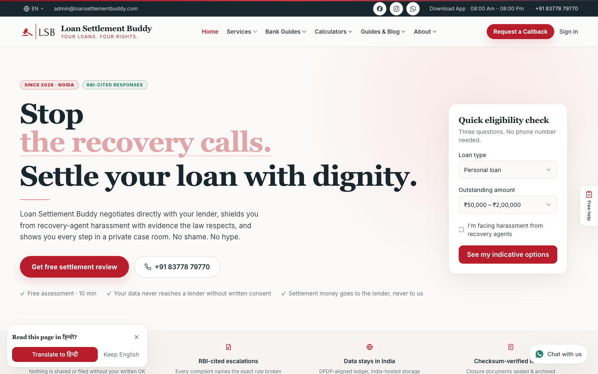
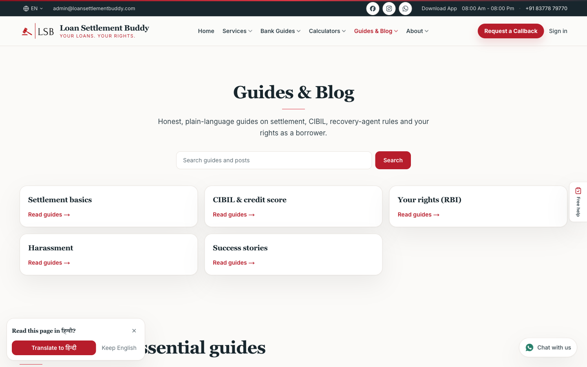
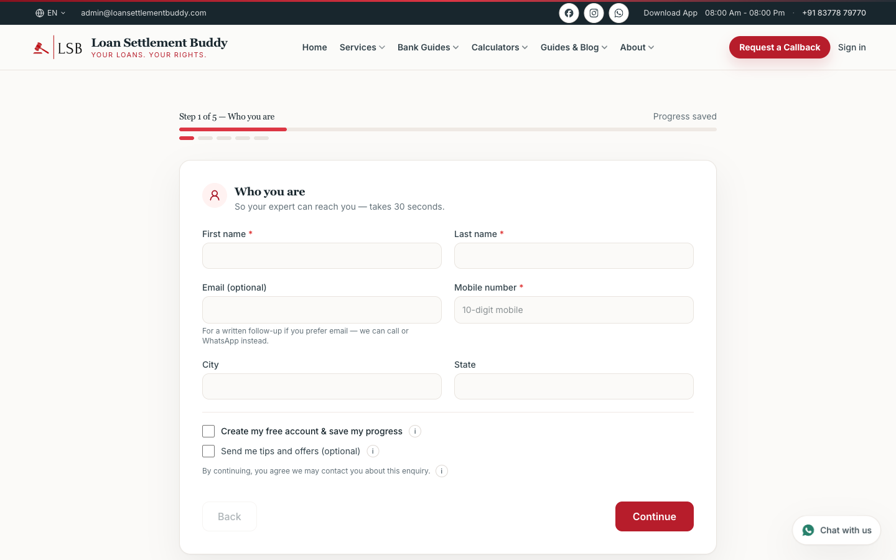
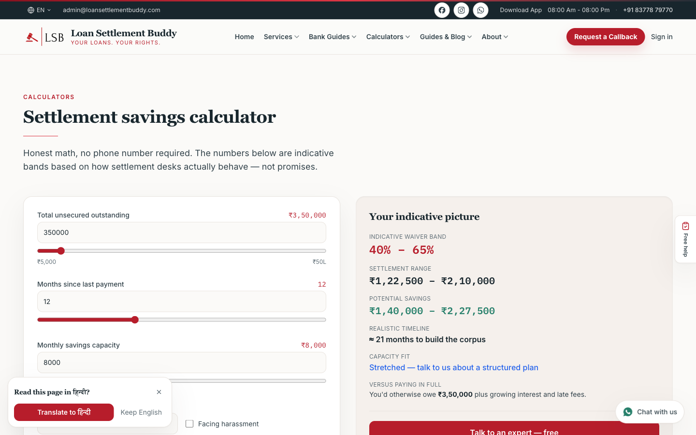
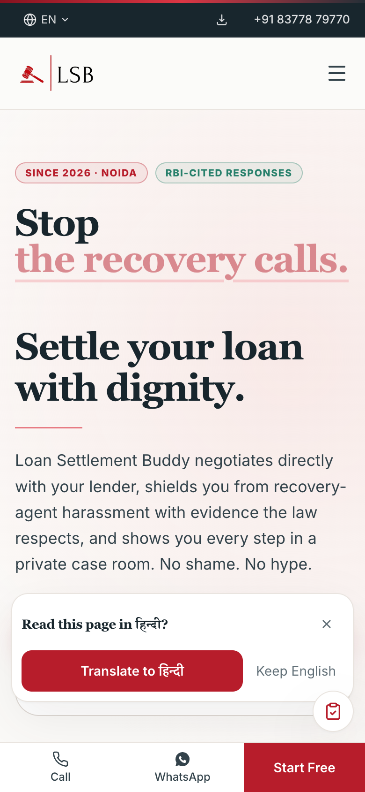
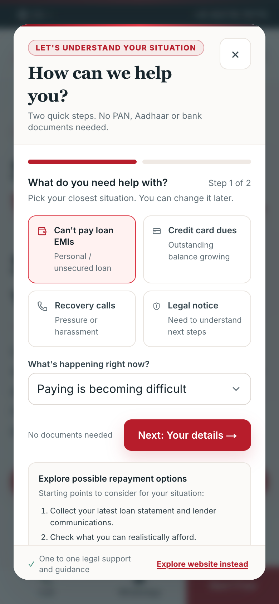
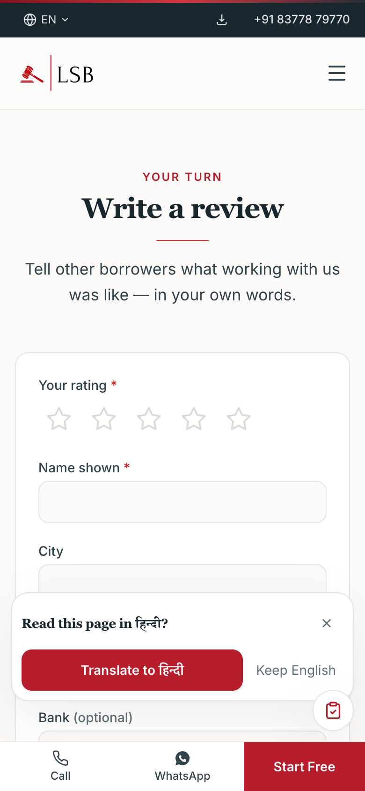
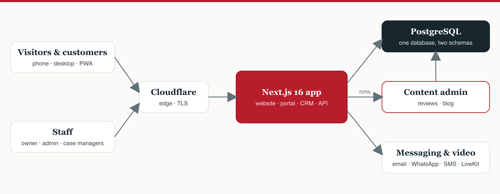

# ⚖️ Loan Settlement Buddy

### Stop the recovery calls. Settle your loan with dignity.

**India's loan-settlement platform — a full website, a private case room for every customer, and an in-house CRM that runs each settlement from first enquiry to the no-dues certificate.**

**[Visit the website →](https://loansettlementbuddy.com)** · **[Release notes →](RELEASES.md)**

> This repository is the public showcase and release history of Loan Settlement Buddy. The source code is private.

---

## 📸 A look inside

| Home | Guides & Blog |
|---|---|
|  |  |
| **Free assessment** | **Settlement savings calculator** |
|  |  |

  
  &nbsp;&nbsp;
  
  &nbsp;&nbsp;
  

---

## 🧭 What we do

People who can no longer pay a loan or a credit card face two problems at once: a debt they cannot clear and recovery agents who call all day. Loan Settlement Buddy negotiates a one-time settlement with the lender, protects the borrower from harassment with evidence the law respects, and shows every step in a private case room.

| Service | What it means for the customer |
|---|---|
| **Personal loan settlement** | A reduced one-time payout that closes the loan, with the letter to prove it |
| **Credit card settlement** | Full-and-final closure when interest and late fees keep compounding |
| **Home, vehicle, education and business loan settlement** | The same process for secured and business borrowing |
| **Anti-harassment service** | Stop recovery calls, with complaints that cite the exact RBI rule broken |
| **Lawyer intervention** | On-ground legal help when agents visit the home or workplace |
| **Paid expert consultations** | One-to-one phone or video sessions, booked and paid online |
| **Free assessment & callback** | A 10-minute assessment and a free callback from an advisor |
| **Credit score tracking & evidence locker** | Track recovery after settlement and store harassment proof safely |

---

## ✨ Highlights

### For visitors
- **70+ pages** — services, bank guides, loan categories, city pages, FAQ, legal pages, Guides & Blog.
- **Two-step quick enquiry** and a **5-step free assessment** with instant scoring, autosave and resume links.
- **6 honest calculators** — debt health, settlement savings, credit score, minimum-due trap, payoff planner, CIBIL recovery.
- **Customer reviews** that only appear after a human approves them — with our public reply under each one.
- **Guides & Blog** with topics, search, contents, FAQ and related articles, written by our case managers.
- **Installable app (PWA)** — one tap to add Loan Settlement Buddy to a phone's home screen.

### For customers
- **A private case room** — every stage, document, offer, message, letter and receipt in one place.
- **Accept offers online** with a typed-name confirmation; download receipts and letters any time.
- **Evidence locker** for recovery-agent harassment and a **credit tracker** for life after settlement.
- **Sign in your way** — mobile OTP, email OTP or password; automatic sign-out on shared devices.
- One account, many cases: come back with another loan and it opens under the same customer.

### For the team (in-house CRM)
- **Leads → customer → case** with a full stage machine, SLA colours and a phone-friendly board.
- **Round-robin auto-assignment**, related leads by mobile, follow-ups, and a "left at payment" callback list.
- **Masked contact details** — every reveal of a phone or email is written to the audit log.
- **Offers, fees, receipts and letters** with duplicate-issue guards and a complete timeline.
- **Bell, email and WhatsApp alerts** per event; **~140 settings** the owner changes without a developer.
- **Content admin** — approve reviews, write and schedule blog posts with images, all with the same staff login.

---

## 🏆 What sets it apart

| | Typical settlement website | Loan Settlement Buddy |
|---|---|---|
| After the enquiry | A form that goes to an inbox | A real CRM: scoring, auto-assignment, follow-ups, case stages |
| Customer visibility | Phone calls only | A private case room with every document, offer and letter |
| Harassment | Advice | Evidence locker + complaints citing the exact RBI rule |
| Language | English (maybe Hindi) | **11 languages**, pre-translated, one tap to switch |
| Privacy | Contact details visible to everyone | Masked by default; every reveal is logged |
| Reviews | Hand-picked quotes | Customers write them; a human approves; we reply in public |
| Content | Developer needed for each article | Staff write, schedule and publish themselves |
| Reliability | Untested | **290 unit/integration tests + 200+ browser tests** on every release |

---

## 🇮🇳 Built for India

- **11 languages** — English, हिन्दी, मराठी, বাংলা, தமிழ், తెలుగు, ಕನ್ನಡ, മലയാളം, ગુજરાતી, ਪੰਜਾਬੀ, ଓଡ଼ିଆ — pre-translated so pages load instantly in every language, with a gentle suggestion based on the visitor's region.
- **₹ and IST everywhere**, Indian mobile numbers, lender-specific guides for India's major banks and NBFCs.
- **DPDP-aligned consent** — nothing reaches a lender without the customer's written consent; marketing consent is never pre-ticked.
- **RBI-cited** — harassment complaints name the exact rule a recovery agent broke.

---

## 🛠️ Tech stack

| Layer | Technology |
|---|---|
| Framework | **Next.js 16** (App Router, Turbopack) — one codebase for website, portal, CRM and API |
| UI | **React 19**, **Tailwind CSS 4** with design tokens, adaptive from 320 px phones to 2560 px screens |
| Language | **TypeScript** (strict) |
| Database | **PostgreSQL 18** with **Drizzle ORM** (one schema, SQLite fallback for local work) |
| Auth | **Better Auth** — password, email OTP, mobile OTP, sessions, rate limits |
| Validation | **Zod** on every API input and every setting |
| Content | **Payload CMS 3** with the Lexical editor — reviews and blog, on the same login |
| Documents | React-PDF letters, server-side PDF generation |
| Video | **LiveKit** for paid video consultations |
| Messaging | SMTP email, WhatsApp, SMS providers — chosen in Settings |
| Translation | **IndicTrans2** (AI4Bharat) — 10 Indian languages, translated offline |
| Testing | **Vitest** (unit + database on two engines) and **Playwright** (sanity · smoke · deep) |
| Delivery | Cloudflare at the edge, full versioned release packages, health checks and rollbacks |

### Architecture

---

## 🔐 Security & privacy

- Security headers and a strict Content-Security-Policy on every page; the staff app is never indexed by search engines.
- Rate limits per network and per account on sign-in, OTP, forms and reviews; bot traps on public forms.
- Concurrency guards — two staff acting on the same lead or letter at once can never create duplicates.
- Every staff action that matters is in an audit log; logs mask phone numbers and emails and redact secrets.
- Uploads are type-checked and scoped to the customer's own cases.

## ✅ Quality

- Three test levels on an isolated server: **sanity**, **smoke** and **deep** journeys (lead → case → offer → fee → receipt).
- Every release is checked by hand in a visible browser on phone and desktop before it goes live.
- Each version ships as a complete package with checksums, a backup-first deploy guide and a one-step rollback.

---

## 📦 Release history

| Version | Date | Headline |
|---|---|---|
| [v1.4.0](RELEASES.md#v140--26-november-2026) | 26 Nov 2026 | Customer reviews, Guides & Blog, content admin |
| [v1.3.0](RELEASES.md#v130--26-november-2026) | 26 Nov 2026 | Quality round: clearer forms, phone layouts, safer staff tools |
| [v1.2.0](RELEASES.md#v120--26-november-2026) | 26 Nov 2026 | Smarter enquiry flow: prospects, related leads, callbacks |
| [v1.1.0](RELEASES.md#v110--24-november-2026) | 24 Nov 2026 | Customer numbers, auto-assignment, alerts, security hardening |
| [v1.0.0](RELEASES.md#v100--22-november-2026) | 22 Nov 2026 | First full version: website, customer portal, CRM |

---

## 🙏 Built with open source

Loan Settlement Buddy stands on excellent open-source work, with thanks to:
[Next.js](https://github.com/vercel/next.js) (MIT) ·
[React](https://github.com/facebook/react) (MIT) ·
[Payload CMS](https://github.com/payloadcms/payload) (MIT) ·
[Tailwind CSS](https://github.com/tailwindlabs/tailwindcss) (MIT) ·
[Drizzle ORM](https://github.com/drizzle-team/drizzle-orm) (Apache-2.0) ·
[Better Auth](https://github.com/better-auth/better-auth) (MIT) ·
[Zod](https://github.com/colinhacks/zod) (MIT) ·
[LiveKit](https://github.com/livekit) (Apache-2.0) ·
[IndicTrans2 by AI4Bharat](https://github.com/AI4Bharat/IndicTrans2) (MIT) ·
[Playwright](https://github.com/microsoft/playwright) (Apache-2.0) ·
[Vitest](https://github.com/vitest-dev/vitest) (MIT) ·
[lucide](https://github.com/lucide-icons/lucide) (ISC).

---

**[loansettlementbuddy.com](https://loansettlementbuddy.com)** — Your loans. Your rights. Your way forward.

Loan Settlement Buddy is a private loan-settlement consultancy, not a bank, NBFC or lender. Settlement is at the lender's discretion; settlement money is always paid directly to the lender.

